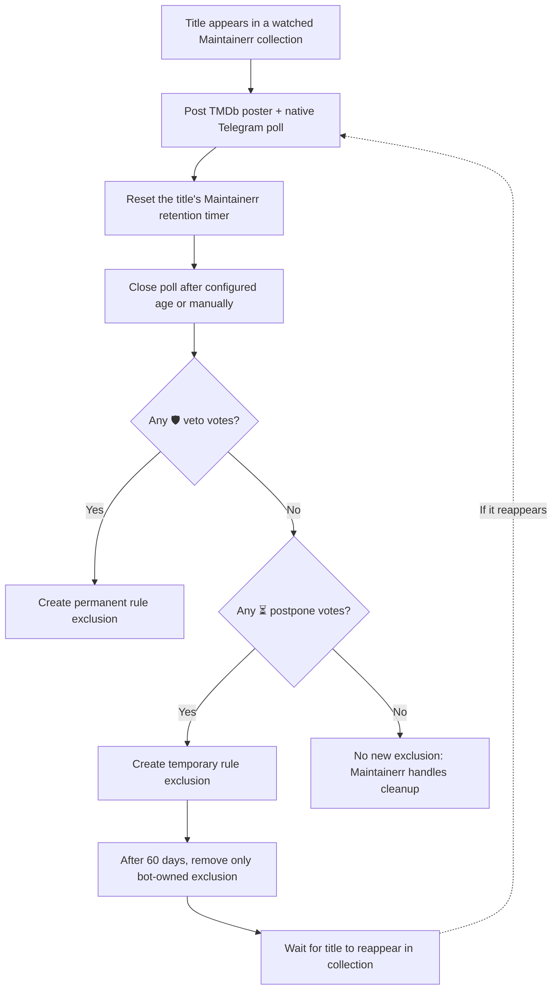

# Maintainerr Telegram Companion

**Let your Telegram group vote on what stays, what gets more time, and what can leave your media library.**

An independent, self-hosted voting companion for [Maintainerr](https://github.com/Maintainerr/Maintainerr). It watches selected Maintainerr collections, posts **native Telegram polls with movie/TV posters**, and translates the results into Maintainerr rule exclusions.

**One veto saves a title.** Otherwise, a postponement vote gives it another 60 days. If nobody votes to protect it, Maintainerr can continue its own cleanup process.

> [!IMPORTANT]
> **Set each Maintainerr rule/collection's “Delete after days” delay to a value GREATER than the poll closing duration.** For example: **29-day poll → 45-day deletion delay**. Otherwise Maintainerr may delete a title before Telegram voting finishes. The bot never deletes media itself, but it resets Maintainerr timers and manages exclusions. See [Deletion safety](#deletion-safety-and-limitations).

## At a glance

| 🗳️ Native Telegram voting | 🛡️ One-vote veto | ⏳ 60-day postponement | 🐳 Self-hosted |
| :--- | :--- | :--- | :--- |
| Anonymous, single-choice polls for movies and TV shows | A single keep vote overrides all other votes | Temporary protection when there are no vetoes | Python + SQLite + Docker Compose; no pip dependencies |

### Example: what your Telegram group sees

The bot sends a **TMDb poster** and a **separate poll replying to that poster**. Here's an illustrative example (not a screenshot of a real chat):

```text
┌───────────────────────────────────────────────┐
│  🖼️ Movie poster                             │
│  Example Movie (2025)                         │
└───────────────────────────────────────────────┘
        ↳ 🎬 Movie scheduled for deletion:
          Example Movie (2025)?

          ○ 🛡️ Prevent deletion permanently (veto)
          ○ ⏳ Postpone deletion by 60 days
          ○ 🗑️ Deletion is okay

          [ Vote ]
```

Polls are anonymous and allow **one choice per voter**. The poll normally stays open for **29 days**, then the companion closes it during its next reconciliation cycle and evaluates the final counts. An administrator can also close eligible polls early using the [manual CLI](#close-polls-early).

### How a vote becomes a Maintainerr decision



**Vote priority is not majority voting.** The first matching rule wins:

| Votes received when the poll closes | Outcome |
| --- | --- |
| **At least one 🛡️ veto** (regardless of other votes) | Protect the title with a permanent Maintainerr rule exclusion |
| **No veto, at least one ⏳ postpone** | Protect the title with a temporary exclusion for 60 days from the actual close time |
| **Neither veto nor postpone** (including zero votes) | No new exclusion; Maintainerr decides whether and when to delete |

The bot tracks the IDs of exclusions it creates for postponements and removes **only its own** when the postponement expires. If an exclusion already exists, it does not claim ownership of that exclusion.

## Quick start

### Requirements

- A running Maintainerr instance with reachable API and one or more collections
- Docker Engine + Compose v2 (or Python 3.13+ for a manual deployment)
- A Telegram bot token from [BotFather](https://t.me/BotFather)
- A Telegram group/chat ID and permission for the bot to post and stop polls
- An existing Docker network shared with Maintainerr

### Install

**1. Clone and configure**

```bash
git clone https://github.com/ensingerphilipp/maintainerr-telegram-companion.git
cd maintainerr-telegram-companion
cp .env.example .env
```

Edit `.env` and provide at least:

```dotenv
MAINTAINERR_URL=http://maintainerr:6246
MAINTAINERR_NETWORK=compose_default
COLLECTION_IDS=1,2
TELEGRAM_BOT_TOKEN=YOUR_BOT_TOKEN
TELEGRAM_CHAT_ID=YOUR_CHAT_ID
PUBLISH_POLLS=false
```

- `COLLECTION_IDS` must match **your** Maintainerr collections; `1,2` is only an example.
- `MAINTAINERR_NETWORK` must be the name of the **existing Docker network** that reaches Maintainerr; `compose_default` is only an example.
- The Telegram bot needs permission to send photos, polls, and stop polls in the target chat.
- Never commit your real `.env` file.

**2. Start in safe mode**

```bash
docker compose up -d
docker compose logs -f maintainerr-telegram-polls
```

With `PUBLISH_POLLS=false`, the companion does not create **new** polls. It can still reconcile existing polls if you reuse a database, so do not point a test deployment at a production database.

**3. Enable publication when ready**

**Before enabling publication or deletion, configure every watched Maintainerr rule/collection so its “Delete after days” delay is strictly longer than `POLL_DAYS`.** With the example values, set Maintainerr to **45 days** and `POLL_DAYS=29` (a nominal **16-day buffer**). Set `RETENTION_DAYS=45` to match Maintainerr. Check collection IDs, Telegram permissions, and [deletion safety](#deletion-safety-and-limitations). Then set `PUBLISH_POLLS=true` in `.env` and recreate the container:

```bash
docker compose up -d --force-recreate
docker compose logs -f maintainerr-telegram-polls
```

The bot runs a reconciliation cycle immediately at startup, then periodically. It publishes at most `MAX_NEW_POLLS_PER_CYCLE` new polls per cycle; repeated restarts can accelerate publication.

## Configuration

| Variable | Example / default | Description |
| --- | --- | --- |
| `MAINTAINERR_URL` | `http://maintainerr:6246` | Maintainerr API URL reachable from the container |
| `MAINTAINERR_NETWORK` | `compose_default` | Name of the existing external Docker network |
| `COLLECTION_IDS` | `1,2` | Comma-separated collection IDs |
| `TELEGRAM_BOT_TOKEN` | **Required** | BotFather token; keep private |
| `TELEGRAM_CHAT_ID` | **Required** | Target Telegram chat/supergroup ID |
| `PUBLISH_POLLS` | `false` in example | Whether to publish new polls |
| `POLL_INTERVAL_SECONDS` | `2400` in example | Seconds between cycles (minimum 60) |
| `MAX_NEW_POLLS_PER_CYCLE` | `2` in example | Limit new polls per cycle |
| `POLL_DAYS` | `29` | Normal minimum poll age before closing |
| `RETENTION_DAYS` | `45` | Expected Maintainerr deletion timer |

**Required timing:** `POLL_DAYS` must be at least 1 and strictly less than `RETENTION_DAYS`. Set Maintainerr's **“Delete after days”** value for each watched rule/collection to match `RETENTION_DAYS` and to occur **after** the poll closes. The bot checks these settings but does not configure the deletion action or retention period. Leave additional time for reconciliation, service outages, and operational delays; the 16-day buffer in the 29/45 example is not a guarantee.

## Close polls early

You can evaluate polls before their normal closing date without changing the scheduler. The CLI defaults to a **dry-run preview**; nothing is closed until you explicitly pass `--execute`.

```bash
# Preview polls that have been open for at least 3 days
docker compose run --rm -T maintainerr-telegram-polls python close_polls.py --days 3

# Close and evaluate those polls for real
docker compose run --rm -T maintainerr-telegram-polls python close_polls.py --days 3 --execute

# Preview all open polls, even those published moments ago
docker compose run --rm -T maintainerr-telegram-polls python close_polls.py --days 0
```

- `--days` accepts values from **0** through `POLL_DAYS`, including fractional days.
- `--days 0 --execute` closes **all open polls** and applies their outcomes. Use it carefully.
- The CLI and background bot use a shared lock to prevent concurrent reconciliation.
- The 60-day postponement period begins when the poll **actually closes**, including an early close.
- Closing a poll changes Telegram and Maintainerr state; it does **not** delete media directly.

### Reliable closing and automatic retries

Chat-changing Telegram calls are paced at least **3.2 seconds apart per chat**, with the pacing state saved in SQLite so the scheduler, CLI, and restarts share the same limit. A 429 also saves the server's cooldown for subsequent requests. This prevents a bulk close from immediately exhausting the group's request allowance.

A final outcome requires a successful `stopPoll` response with the expected poll ID, a closed flag, and valid option counts. That acknowledged response is durably recorded before votes are applied, so downstream failures can reuse it without another stop request. A cached `is_closed` flag obtained by editing a message is never a final result.

A failed close remains an ordinary open poll with its close request recorded. The next scheduler cycle automatically retries it, even if an administrator requested the close before `POLL_DAYS`. There is no manual hold state or special recovery flag. Actual Telegram errors remain fully logged, and failed requests never authorize vote outcomes.

### Automatic session recovery

The bot and executing CLI recognize the specific HTTP/API 400 descriptions `poll can't be stopped` and `poll has already been closed` for a tracked original poll with no acknowledged final response. They confirm the failure with one paced retry. Two matching failures queue recovery; unrelated 400s, permissions errors, missing metadata, and 429s alone do not trigger a reset. This identifies a suspected session inconsistency, not proof that a poll is closed.

Recovery is shared across the affected batch under the scheduler/CLI execution lock. It checks the bot identity and verifies that no webhook is configured, calls Telegram's `close` method, reconnects with `getMe`, and retries the original poll closures. It does not change webhooks, call `logOut`, edit messages, or consume/acknowledge pending updates. Only a successful, validated `stopPoll` response authorizes final votes. The normal scheduler also resumes Maintainerr outcomes left pending after a successful close; the CLI resumes those outcomes during `--execute`.

The SQLite tables `poll_close_incidents` and `telegram_session_recovery` persist the recovery phase, target IDs, failure reason/count, reset generation, and retry deadlines. Telegram's `retry_after` is respected without sleeping through session recovery cooldowns. Temporary reconnect errors use bounded exponential backoff. The scheduler shortens its next sleep when recovery is due. After downtime it resumes the saved phase using calendar time; it does not replay missed resets or require an extra ten-minute wait after reconnecting.

A reset reserves a **one-hour global cooldown before the external call**, and each unresolved poll incident gets at most one recovery reset. A restart around an ambiguous `close` probes the connection instead of blindly issuing another reset. A poll that still returns the same error after recovery remains open with an ERROR diagnostic and at most hourly closure retries; it cannot repeatedly reset the API instance. Identity mismatches, configured webhooks, and nonretryable recovery errors block automatic reset and produce an ERROR diagnostic while preserving poll data. No periodic or startup reset is performed.

The CLI reports **PENDING**, rather than DONE, when recovery or Maintainerr reconciliation is incomplete. Exit status is **0** for completed work, **1** for failures, and **2** for pending work without another failure. The scheduler continues pending recovery after the CLI exits. All recovery steps are included in the normal structured logs with poll IDs and a reset generation; no manual recovery files are generated.

Upgrades discard the superseded unverified snapshots and review table while retaining acknowledged final results. Existing premature exclusions from the earlier incorrect recovery must be reconciled separately; the journal migration never deletes arbitrary Maintainerr protections.

### Telegram rate limits

Both the scheduled bot and manual CLI use the same Telegram request handler. On HTTP 429 or a JSON response with error code 429, it waits for Telegram's `parameters.retry_after` seconds plus a one-second buffer, then retries the identical request. Without a valid retry delay it uses exponential backoff (5, 10, 20, 40, then 60 seconds). Each request permits five retries; exhaustion leaves its error visible and an unprocessed poll available for a later attempt. Long waits are logged and split into at most 60-second sleeps.

Ambiguous network timeouts are not blindly retried: a timed-out `sendPoll` or `sendPhoto` may already have succeeded. Failed closes remain open and are automatically retried by the scheduler; no cached closure error is treated as success.

### Stale polls with missing Maintainerr metadata

A confirmed empty response from `/api/media-server/meta/{media_id}`, or Maintainerr's explicit `Failed - no metadata` result for that media ID, marks the poll `stale`. The bot logs the title, collection/media/poll/message IDs, reason, and cleanup deadline. Stale polls are ignored for closure and outcome processing, including retries of exclusions. The manual CLI counts them as ignored rather than failed.

The scheduler checks whether metadata has returned. If it has, the saved previous state is restored. If metadata is still absent once the poll reaches **29 days after publication**, the full record is copied to `stale_poll_archive` and removed from the active `polls` table. Archived data retains votes, message IDs, and exclusion ownership. Telegram posts and existing Maintainerr exclusions are left in place. A stale collection entry cannot cause republication while its media ID still lacks metadata.

HTTP errors, timeouts, malformed responses, mismatched media IDs, and unrelated exclusion errors remain visible errors. They do not establish that metadata is missing and never authorize archival. A Telegram 400 also does not make a poll stale: it is a separate closure error.

### Diagnostic logging

At the default INFO level, poll closure attempts include the title, collection/media IDs, Telegram chat/message/poll IDs, prior state, and age threshold. Telegram failures include a correlation ID shared across retries, method, target IDs, attempt number, elapsed time, HTTP status, API error code, exact description, response parameters, retry delay, selected response headers, and the sanitized response body. Non-JSON error bodies are retained as text; diagnostic values are capped at 8192 characters. Network failures identify the exception and report an unknown outcome without blindly repeating a possibly completed send.

Successful stop responses log their source, poll ID, closed flag, and final option counts. Both the scheduler and CLI attach poll identifiers to their exception tracebacks. Bot tokens and credential-bearing Telegram URLs are redacted; complete request payloads are not logged. The CLI writes diagnostics to stderr, so capture both stdout and stderr when saving a run. Scheduled diagnostics are available through `docker compose logs maintainerr-telegram-polls`.

### When Telegram considers a poll closed

A server-confirmed closed poll no longer accepts votes. A Bot API `Poll.is_closed` flag may instead reflect an optimistic TDLib cache after a failed stop; neither that cached flag nor an HTTP 400 error authorizes a final outcome.

Telegram can automatically close a poll if its creator specifies `open_period` or `close_date`. It can also be explicitly stopped through an authorized UI/API action, and the Bot API can create an immediately closed preview using `is_closed=true`. The companion sets none of those creation parameters: `POLL_DAYS` is its own scheduling threshold, followed by a `stopPoll` request.

The companion has no vote-count or all-members-voted closing rule. Telegram's documented automatic closing controls are the optional duration/deadline parameters; a greyed-out voting UI for an individual user is not sufficient evidence of a globally closed poll. The Bot API poll object has no field identifying who stopped a poll or the actual time of an unscheduled closure, so cached counts alone cannot establish its historical cause. TDLib may also omit timer fields once it considers a poll closed; their absence in a closed snapshot does not prove that no timer was originally set.

References: [Telegram Poll](https://core.telegram.org/bots/api#poll), [sendPoll](https://core.telegram.org/bots/api#sendpoll), [stopPoll](https://core.telegram.org/bots/api#stoppoll), [Telegram poll protocol](https://core.telegram.org/api/poll).

## Deletion safety and limitations

> [!WARNING]
> **Maintainerr deletion must happen AFTER poll closure.** For each watched rule or collection, set “Delete after days” greater than `POLL_DAYS`. For example, a 29-day poll and a 45-day deletion delay provide a nominal 16-day buffer. The deletion timer runs independently of voting: extended downtime can still result in deletion before a veto is processed. There is no fail-safe ordering or distributed transaction. Test thoroughly before enabling deletion.

- **Retention reset:** When publishing a poll, the companion calls Maintainerr's postpone endpoint to reset that title's deletion timer. Configure the same retention interval in Maintainerr and `RETENTION_DAYS`.
- **No automatic deletion:** The companion never calls a media-delete endpoint and never changes the collection's deletion action. With no protection votes, the outcome is simply *no new exclusion*.
- **Temporary exclusion expiry:** After 60 days, the companion removes only the exclusions it created, then waits for Maintainerr to surface the title again. It does **not** force a rule re-evaluation; a new poll depends on the title reappearing.
- **Existing protection:** A pre-existing exclusion is not treated as a bot-owned temporary exclusion.
- **State persistence:** The SQLite database contains poll rounds, Telegram message IDs, vote counts, and exclusion ownership. Do not reset it while polls or exclusions are active.
- **Polling interval:** Closing happens on a reconciliation cycle, not necessarily at the exact second a poll reaches its configured age.
- **Posters:** A poster and its poll are two Telegram messages, not a single combined media message.
- **Platform scope:** Exclusions are Maintainerr rule exclusions, not Radarr/Sonarr/Jellyfin tags.

## Operations and development

The bot stores its state in `polls.sqlite` in the mounted directory. Back up the database using SQLite's backup API while the service is running. A database deleted mid-operation cannot be reliably reconstructed from Telegram.

Useful commands:

```bash
# Follow service logs
docker compose logs -f maintainerr-telegram-polls

# Run local offline tests (no Telegram or Maintainerr access required)
python3 -m unittest discover -s tests -v

# Syntax check
python3 -m compileall -q bot.py voting.py covers.py close_polls.py recovery.py
```

The bot has no admin web interface or inbound Telegram commands. Poll management is performed using the CLI.

## Security, attribution and license

- Only `.env.example` is versioned. Keep your real `.env`, SQLite database, backups, logs, and bot tokens private.
- Review `git diff --cached` before publishing any changes.
- This is an **independent community project**, not an official Maintainerr integration.
- Licensed under the **[MIT License](LICENSE)**.
