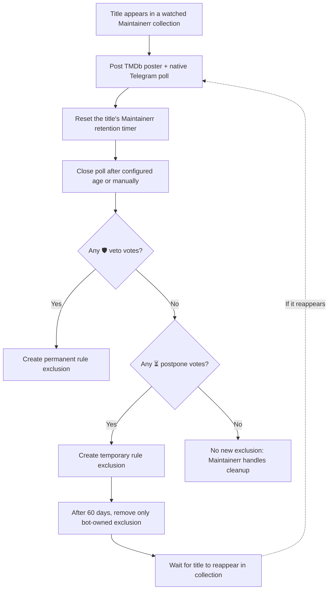

# Maintainerr Telegram Companion

**Let your Telegram group vote on what stays, what gets more time, and what can leave your media library.**

An independent, self-hosted voting companion for [Maintainerr](https://github.com/Maintainerr/Maintainerr). It watches selected Maintainerr collections, posts **native Telegram polls with movie/TV posters**, and translates the results into Maintainerr rule exclusions.

**One veto saves a title.** Otherwise, a postponement vote gives it another 60 days. If nobody votes to protect it, Maintainerr can continue its own cleanup process.

> [!IMPORTANT]
> **This bot never deletes media.** Maintainerr handles deletion according to its own settings and schedule. The companion **does** reset Maintainerr retention timers when polls are created and add/remove exclusions based on votes. Read [Deletion safety](#deletion-safety-and-limitations) before enabling automatic deletion in Maintainerr.

## At a glance

| 🗳️ Native Telegram voting | 🛡️ One-vote veto | ⏳ 60-day postponement | 🐳 Self-hosted |
| :--- | :--- | :--- | :--- |
| Anonymous, single-choice polls for movies and TV shows | A single keep vote overrides all other votes | Temporary protection when there are no vetoes | Python + SQLite + Docker Compose; no pip dependencies |

### Example: what your Telegram group sees

The bot sends a **TMDb poster** and a **separate poll replying to that poster**. Here's an illustrative example (not a screenshot of a real chat):

```text
┌───────────────────────────────────────────────┐
│  🖼️ Movie poster                             │
│  Example Movie (2025)                         │
└───────────────────────────────────────────────┘
        ↳ 🎬 Movie scheduled for deletion:
          Example Movie (2025)?

          ○ 🛡️ Prevent deletion permanently (veto)
          ○ ⏳ Postpone deletion by 60 days
          ○ 🗑️ Deletion is okay

          [ Vote ]
```

Polls are anonymous and allow **one choice per voter**. The poll normally stays open for **29 days**, then the companion closes it during its next reconciliation cycle and evaluates the final counts. An administrator can also close eligible polls early using the [manual CLI](#close-polls-early).

### How a vote becomes a Maintainerr decision



**Vote priority is not majority voting.** The first matching rule wins:

| Votes received when the poll closes | Outcome |
| --- | --- |
| **At least one 🛡️ veto** (regardless of other votes) | Protect the title with a permanent Maintainerr rule exclusion |
| **No veto, at least one ⏳ postpone** | Protect the title with a temporary exclusion for 60 days from the actual close time |
| **Neither veto nor postpone** (including zero votes) | No new exclusion; Maintainerr decides whether and when to delete |

The bot tracks the IDs of exclusions it creates for postponements and removes **only its own** when the postponement expires. If an exclusion already exists, it does not claim ownership of that exclusion.

## Quick start

### Requirements

- A running Maintainerr instance with reachable API and one or more collections
- Docker Engine + Compose v2 (or Python 3.13+ for a manual deployment)
- A Telegram bot token from [BotFather](https://t.me/BotFather)
- A Telegram group/chat ID and permission for the bot to post and stop polls
- An existing Docker network shared with Maintainerr

### Install

**1. Clone and configure**

```bash
git clone https://github.com/ensingerphilipp/maintainerr-telegram-companion.git
cd maintainerr-telegram-companion
cp .env.example .env
```

Edit `.env` and provide at least:

```dotenv
MAINTAINERR_URL=http://maintainerr:6246
MAINTAINERR_NETWORK=compose_default
COLLECTION_IDS=1,2
TELEGRAM_BOT_TOKEN=YOUR_BOT_TOKEN
TELEGRAM_CHAT_ID=YOUR_CHAT_ID
PUBLISH_POLLS=false
```

- `COLLECTION_IDS` must match **your** Maintainerr collections; `1,2` is only an example.
- `MAINTAINERR_NETWORK` must be the name of the **existing Docker network** that reaches Maintainerr; `compose_default` is only an example.
- The Telegram bot needs permission to send photos, polls, and stop polls in the target chat.
- Never commit your real `.env` file.

**2. Start in safe mode**

```bash
docker compose up -d
docker compose logs -f maintainerr-telegram-polls
```

With `PUBLISH_POLLS=false`, the companion does not create **new** polls. It can still reconcile existing polls if you reuse a database, so do not point a test deployment at a production database.

**3. Enable publication when ready**

Check the collection IDs, Maintainerr retention settings, Telegram permissions, and [deletion safety](#deletion-safety-and-limitations). Then set `PUBLISH_POLLS=true` in `.env` and recreate the container:

```bash
docker compose up -d --force-recreate
docker compose logs -f maintainerr-telegram-polls
```

The bot runs a reconciliation cycle immediately at startup, then periodically. It publishes at most `MAX_NEW_POLLS_PER_CYCLE` new polls per cycle; repeated restarts can accelerate publication.

## Configuration

| Variable | Example / default | Description |
| --- | --- | --- |
| `MAINTAINERR_URL` | `http://maintainerr:6246` | Maintainerr API URL reachable from the container |
| `MAINTAINERR_NETWORK` | `compose_default` | Name of the existing external Docker network |
| `COLLECTION_IDS` | `1,2` | Comma-separated collection IDs |
| `TELEGRAM_BOT_TOKEN` | **Required** | BotFather token; keep private |
| `TELEGRAM_CHAT_ID` | **Required** | Target Telegram chat/supergroup ID |
| `PUBLISH_POLLS` | `false` in example | Whether to publish new polls |
| `POLL_INTERVAL_SECONDS` | `2400` in example | Seconds between cycles (minimum 60) |
| `MAX_NEW_POLLS_PER_CYCLE` | `2` in example | Limit new polls per cycle |
| `POLL_DAYS` | `29` | Normal minimum poll age before closing |
| `RETENTION_DAYS` | `45` | Expected Maintainerr deletion timer |

`POLL_DAYS` must be at least 1 and less than `RETENTION_DAYS`. Set the corresponding retention period in Maintainerr itself: the bot **checks** the collection settings but does not configure the collection deletion action or retention period.

## Close polls early

You can evaluate polls before their normal closing date without changing the scheduler. The CLI defaults to a **dry-run preview**; nothing is closed until you explicitly pass `--execute`.

```bash
# Preview polls that have been open for at least 3 days
docker compose run --rm -T maintainerr-telegram-polls python close_polls.py --days 3

# Close and evaluate those polls for real
docker compose run --rm -T maintainerr-telegram-polls python close_polls.py --days 3 --execute

# Preview all open polls, even those published moments ago
docker compose run --rm -T maintainerr-telegram-polls python close_polls.py --days 0
```

- `--days` accepts values from **0** through `POLL_DAYS`, including fractional days.
- `--days 0 --execute` closes **all open polls** and applies their outcomes. Use it carefully.
- The CLI and background bot use a shared lock to prevent concurrent reconciliation.
- The 60-day postponement period begins when the poll **actually closes**, including an early close.
- Closing a poll changes Telegram and Maintainerr state; it does **not** delete media directly.

## Deletion safety and limitations

> [!WARNING]
> **Maintainerr's deletion timer is independent of Telegram voting.** If the companion is offline long enough, Maintainerr may delete media before the companion processes a veto. This project does not provide a fail-safe ordering mechanism or distributed transaction. Test your deployment thoroughly before enabling real deletion in Maintainerr.

- **Retention reset:** When publishing a poll, the companion calls Maintainerr's postpone endpoint to reset that title's deletion timer. Configure the same retention interval in Maintainerr and `RETENTION_DAYS`.
- **No automatic deletion:** The companion never calls a media-delete endpoint and never changes the collection's deletion action. With no protection votes, the outcome is simply *no new exclusion*.
- **Temporary exclusion expiry:** After 60 days, the companion removes only the exclusions it created, then waits for Maintainerr to surface the title again. It does **not** force a rule re-evaluation; a new poll depends on the title reappearing.
- **Existing protection:** A pre-existing exclusion is not treated as a bot-owned temporary exclusion.
- **State persistence:** The SQLite database contains poll rounds, Telegram message IDs, vote counts, and exclusion ownership. Do not reset it while polls or exclusions are active.
- **Polling interval:** Closing happens on a reconciliation cycle, not necessarily at the exact second a poll reaches its configured age.
- **Posters:** A poster and its poll are two Telegram messages, not a single combined media message.
- **Platform scope:** Exclusions are Maintainerr rule exclusions, not Radarr/Sonarr/Jellyfin tags.

## Operations and development

The bot stores its state in `polls.sqlite` in the mounted directory. Back up the database using SQLite's backup API while the service is running. A database deleted mid-operation cannot be reliably reconstructed from Telegram.

Useful commands:

```bash
# Follow service logs
docker compose logs -f maintainerr-telegram-polls

# Run local offline tests (no Telegram or Maintainerr access required)
python3 -m unittest discover -s tests -v

# Syntax check
python3 -m compileall -q bot.py voting.py covers.py close_polls.py
```

The bot has no admin web interface or inbound Telegram commands. Poll management is performed using the CLI.

## Security, attribution and license

- Only `.env.example` is versioned. Keep your real `.env`, SQLite database, backups, logs, and bot tokens private.
- Review `git diff --cached` before publishing any changes.
- This is an **independent community project**, not an official Maintainerr integration.
- Licensed under the **[MIT License](LICENSE)**.
